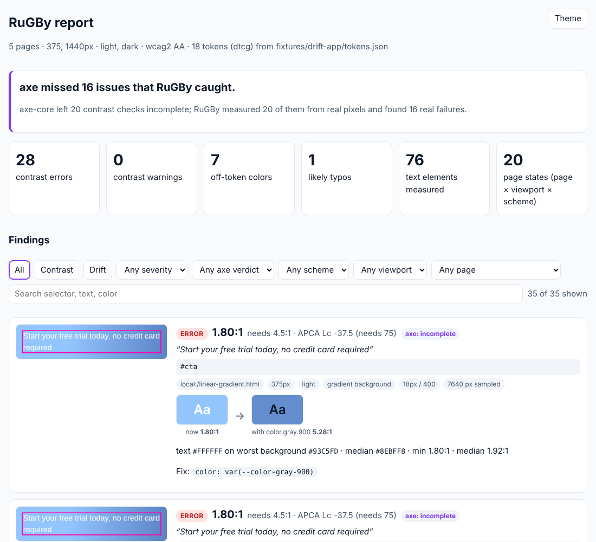

# RuGBy

**Your design system says one color; the browser paints another. RuGBy measures the pixels the browser actually renders: text contrast over gradients, photos, scrims, glass and blend modes, where axe-core gives up, plus every off-token color traced back to the CSS rule that produced it.**

```sh
npx rugby audit http://localhost:3000 --tokens tokens.json
```

## 30-second quickstart

```sh
# 1. Audit a running app (or a static build folder, or an .html file)
npx rugby audit http://localhost:3000 --tokens tokens.json

# 2. Open the report: annotated screenshots, axe comparison, fix suggestions
open rugby-report/index.html

# 3. Check a single pair
npx rugby contrast "#777" "#fff"
#   WCAG 2.x  4.48:1  fail AA (needs 4.5:1)
#   APCA      Lc 71.1  fail (needs |Lc| 90)
```

Node ≥ 20. RuGBy drives Chromium through Playwright. If you don't have a Chromium for Playwright yet, run `npx playwright-core install chromium` once. Exit codes: `0` clean, `1` findings matching `--fail-on`, `2` bad input, `3` internal error.



## axe vs RuGBy

axe-core powers Lighthouse and most CI accessibility checks. It can't evaluate text over gradients, background images, translucent layers, `mix-blend-mode` or `backdrop-filter`, so it reports those as **incomplete**, and most CI setups treat incomplete as a pass ([dequelabs/axe-core#4628](https://github.com/dequelabs/axe-core/issues/4628), [#975](https://github.com/dequelabs/axe-core/issues/975)). RuGBy hides the text, screenshots what is really behind it, and measures every pixel.

On the 32 text elements in this repo's [fixture pages](fixtures/pages), whose correct ratios are [computed from first principles](scripts/compute-expected.mjs), axe-core agreed on 24, left 7 incomplete, and got 1 wrong. RuGBy matched all 32 within ±0.05:

| Fixture | Element | True ratio | Correct | axe-core | RuGBy |
|---|---|---:|---|---|---|
| linear-gradient | white CTA on a pale-to-navy gradient | 1.80:1 | fail | **incomplete** | fail ✔ |
| linear-gradient | dark text on a pale gradient | 12.48:1 | pass | **incomplete** | pass ✔ |
| radial-gradient | white text over a bright radial core | 1.25:1 | fail | **incomplete** | fail ✔ |
| photo | caption on a photo with a pale sky | 1.23:1 | fail | **incomplete** | fail ✔ |
| overlay-photo | white text on a 40% scrim over a bright photo | 2.85:1 | fail | **incomplete** | fail ✔ |
| glass | white text on a `backdrop-filter: blur()` card | 4.43:1 | fail | **incomplete** | fail ✔ |
| glass | muted blue text on the same card | 2.46:1 | fail | **incomplete** | fail ✔ |
| blend-difference | `mix-blend-mode: difference` text that turns near-black | 14.32:1 | pass | **fail** | pass ✔ |

The other 24 (solid backgrounds, opacity stacks, fixed headers, iframes, scroll containers, both dark-mode mechanisms, Display-P3, a long page that re-lays-out during capture) agree, and the end-to-end test checks every row on every run. Real-world results from public sites are in [docs/case-studies.md](docs/case-studies.md).

## What it checks

**Contrast.** For each page × viewport × color scheme, RuGBy:

1. collects visible text per line box (`Range.getClientRects()`), through shadow DOM and same-origin iframes, clipped by scroll containers;
2. makes those elements' text transparent in batches, takes one full-page screenshot per batch (DPR 1, sRGB), and samples every background pixel under every line;
3. composites the text color with its effective opacity (multiplied up the tree) and blend mode against each pixel;
4. reports the **5th-percentile** WCAG ratio as the verdict (so one stray anti-aliased pixel doesn't decide it), plus the minimum, the median and APCA Lc;
5. records what axe-core said about the same element on the same page state;
6. suggests the nearest token that passes, re-measured over the same pixels.

**Drift.** Every painted `color`, `background-color`, border, outline, `text-decoration-color`, SVG `fill`/`stroke` and box-shadow color is composited the way CSS paints it (through `opacity`, `filter` and translucent backgrounds) and matched to the nearest token by OKLab ΔE. Off-token colors are traced through the Chrome DevTools Protocol to the winning rule, stylesheet and line. Near-copies (ΔE < 0.5) are labeled `likely-typo`. Each finding gets a concrete edit: `#6b7281 → var(--color-gray-500)` or `text-[#6b7281] → text-gray-500`.

## Commands

```
rugby audit <url-or-file...> [options]   audit pages, files or build folders
rugby tokens [file]                      parse and print the normalized token set
rugby contrast <fg> <bg> [--size --weight --level --json]
rugby fixture                            regenerate the lossless all-RGB test PNG
```

`audit` options:

| Flag | Default | Meaning |
|---|---|---|
| `--tokens <path>` | auto-detect | W3C design tokens JSON, a Tailwind config, or a CSS file with custom properties. A comma list or a directory also works. `none` skips drift. |
| `--viewports <list>` | `375,1440` | viewport widths in px |
| `--schemes <list>` | `light,dark` | emulated `prefers-color-scheme` values |
| `--standard <wcag2\|apca\|both>` | `wcag2` | which contrast model decides pass/fail |
| `--level <AA\|AAA>` | `AA` | WCAG level |
| `--drift-threshold <ΔE>` | `2.0` | OKLab ΔE (×100) above which a color is off-token |
| `--json` | off | print the JSON report to stdout |
| `--html <path>` / `--no-html` | `rugby-report/index.html` | HTML report; screenshots and `report.json` go next to it |
| `--fail-on <list>` | `contrast` | `contrast`, `drift` or `none` |
| `--sitemap <url>` | | audit the pages in a sitemap |
| `--max-pages <n>` | `10` | limit for `--sitemap` and build folders |
| `--selector <css>` | `body` | limit the audit to part of the page |
| `--hide <selector>` | | hide modals or banners before measuring (repeatable); common consent banners are hidden by default (`--no-default-hide`) |
| `--dark-class <name>` | | class toggled on `<html>` for the dark scheme (Tailwind `darkMode: "class"`) |
| `--include-checks` | off | include every measured text element, passing or not |
| `--timestamps` | off | add `generatedAt` (output is otherwise deterministic) |
| `--concurrency <n>` | `4` | pages measured in parallel |
| `--no-axe`, `--no-drift` | | skip the axe comparison or drift detection |

Local `.html` files and build folders are served by a built-in static server, so relative assets and same-origin iframes behave as in production. Public hosts get at most one navigation every 2 seconds.

## Tokens

RuGBy normalizes three formats to one token list (`rugby tokens <file>` prints it):

- **W3C Design Tokens** (`*.tokens.json`): groups, `$value`, inherited `$type`, `{alias}` references (circular aliases are a clear error), the 2025 color-object format, and modes as separate files (`light.tokens.json`, `dark.tokens.json`) or under `$extensions.mode`.
- **Tailwind**: `tailwind.config.{js,ts,cjs,mjs}` through `tailwindcss/resolveConfig` from your project, flattened `theme.colors`. Tailwind v4 CSS-first `@theme { --color-*: … }` blocks are read as CSS.
- **CSS custom properties**: `:root`, `@theme`, `.dark`, `[data-theme=…]` and `prefers-color-scheme` blocks, nested `var()` and shadcn-style bare HSL (`222.2 84% 4.9%`).

Auto-detection order: `--tokens`, then `tokens.json` / `*.tokens.json`, then a Tailwind config in the working directory, then each page's computed `:root` custom properties.

## Report

`--json` output follows [docs/report-schema.md](docs/report-schema.md) and [schema/report.schema.json](schema/report.schema.json). Abridged:

```json
{
  "type": "contrast", "severity": "error", "page": "http://localhost:3000/pricing",
  "viewport": 375, "scheme": "dark", "selector": "main > section.hero h2", "text": "Start your free trial",
  "foreground": "#9CA3AF", "background": { "kind": "gradient", "worst": "#D1D5DB", "median": "#E5E7EB", "sampled": 412 },
  "wcag": { "ratio": 1.72, "min": 1.6, "median": 1.9, "required": 4.5, "pass": false },
  "apca": { "lc": -28.1, "required": 75, "pass": false },
  "axeVerdict": "incomplete",
  "suggestion": { "token": "color.gray.700", "value": "#374151", "ratio": 7.1, "replacement": "color: var(--color-gray-700)" },
  "screenshot": "rugby-report/shots/0007.png"
}
```

The HTML report is one self-contained file that works offline. It has a summary, an "axe missed N issues that RuGBy caught" headline, filters, annotated screenshots, before/after swatches and a token palette (used, unused, drifted). It supports light and dark themes and is readable on a phone. Terminal output is grouped and colored, and prints a single line when there's nothing to report.

## CI

```yaml
# .github/workflows/colors.yml
jobs:
  rugby:
    runs-on: ubuntu-latest
    steps:
      - uses: actions/checkout@v5
      - run: npm ci && npm run build          # your site
      - uses: waseem091/RuGBy@main
        with:
          build-dir: dist                     # or: url: https://preview.example.com
          tokens: tokens.json
          fail-on: contrast                   # contrast, drift, both or none
```

The action uploads `rugby-report/` as an artifact, writes the terminal output to the job summary, and fails the job according to `fail-on`. Inputs: `url`, `build-dir`, `tokens`, `fail-on`, `viewports`, `schemes`, `max-pages`, `dark-class`, `args`, `report-name`.

## MCP and agents

`rugby-mcp` is a stdio MCP server with three read-only tools that return the JSON report, so an agent can audit, apply a suggestion, and audit again:

- `rugby_audit` — `targets`, `tokens`, `viewports`, `schemes`, `standard`, `level`, `selector`, `darkClass`, `maxPages`, `includeChecks`
- `rugby_contrast` — `foreground`, `background`, `fontSizePx`, `fontWeight`, `level`
- `rugby_tokens` — `path`

```json
{ "mcpServers": { "rugby": { "command": "npx", "args": ["-y", "-p", "rugby", "rugby-mcp"] } } }
```

It writes nothing except the report folder. [AGENTS.md](AGENTS.md) and [skills/rugby/SKILL.md](skills/rugby/SKILL.md) tell coding agents when to run RuGBy and how to act on the findings.

## Node API

```ts
import { audit, checkContrast, loadTokens } from "rugby";

const report = await audit({ targets: ["http://localhost:3000"], tokens: "tokens.json", viewports: [375, 1440] });
const errors = report.findings.filter((f) => f.type === "contrast" && f.severity === "error");

checkContrast("#777", "#fff").wcag.ratio; // 4.48
```

The color math is also exported on its own: `import { parseColor, contrastRatio, apcaContrast, deltaE } from "rugby/color"`.

## Accuracy

- The color core (CSS color parsing, sRGB ↔ linear ↔ OKLab/OKLCH, Display-P3 and other wide gamuts with CSS Color 4 gamut mapping, compositing, blend modes, filters, WCAG 2.x, APCA 0.0.98G-4g, ΔE) is checked against [culori](https://culorijs.org) over **all 16,777,216 sRGB colors** (`RUGBY_EXHAUSTIVE=1`), read from a lossless all-RGB PNG that `rugby fixture` regenerates.
- 17 fixture pages cover gradients, photos, scrims, blend modes, glass, text shadows, scroll containers, fixed headers, iframes, both dark-mode mechanisms, Display-P3, opacity and a long page that re-lays-out during capture, each with expected results derived from first principles.
- A drift fixture app plants five off-token colors (hard-coded hex, Tailwind arbitrary value, opacity stack, filter, dark-mode override). RuGBy reports exactly those five, traced to the right rules, with no false positives.
- Every suggestion in the fixture suite is applied to the page, re-rendered and re-measured, and must pass.

## Limitations

- Contrast is measured for HTML text with a solid fill. Text painted with `background-clip: text`, SVG `<text>`, text in `<canvas>`, images of text and cross-origin iframes are skipped and noted.
- `text-shadow` and `-webkit-text-stroke` are ignored for the measurement and noted on the finding. A heavy shadow can make text readable that RuGBy reports as failing.
- Drift composites solid colors exactly, but colors over background images are approximate (noted as a cause). Colors only reachable through `:hover`/`:focus` states aren't triggered.
- Text scrolled out of view inside a scroll container is not measured. Pages taller than 20,000px are measured down to that height.
- APCA's minimum-Lc lookup was transcribed from the published table; check it against apca-w3 if you rely on `--standard apca` (see [DECISIONS.md](DECISIONS.md)).
- Chromium only.

## Development

```sh
pnpm install          # also builds dist/
pnpm test             # Vitest: unit, fixtures end to end, report, MCP
pnpm run lint         # Biome
pnpm run typecheck
RUGBY_EXHAUSTIVE=1 pnpm exec vitest run test/color/exhaustive.test.ts
```

See [CONTRIBUTING.md](CONTRIBUTING.md). Design decisions and their alternatives are in [DECISIONS.md](DECISIONS.md).

## History

RuGBy began as a Figma plugin and "all-RGB pixel engine" that turned hex ranges into one-pixel rectangles and stitched all 16,777,216 RGB colors into a 4096×4096 image. The plugin now lives in [`legacy/figma/`](legacy/figma). The all-RGB image survives as `rugby fixture`, the lossless test image that the color math is checked against, color by color.

## License

[MIT](LICENSE)
