# Case studies: RuGBy on public sites

RuGBy audited the home page and one content page of well-known public sites. These numbers are what it measured; they say nothing about how much the teams behind these sites care about accessibility, and many findings are in decorative illustrations and product mock-ups.

**Across 10 sites, axe-core left 3636 contrast checks incomplete; RuGBy resolved 3636 of them from real pixels, and 605 were real failures.** In all, 887 of RuGBy's contrast failures were elements that axe passed, left incomplete, or did not check. (Counts are page states: the same element at two viewports and two schemes counts up to four times.)

## How these numbers were produced

- Each site: the home page plus one content page, at 375px and 1440px, in light and dark (`prefers-color-scheme`), so 8 page states per site.
- Read-only page loads from a GitHub-hosted runner (`.github/workflows/case-studies.yml`), at most one page every 2 seconds per host. No logins, no forms, no interaction beyond scrolling once for lazy content. Common cookie banners were hidden.
- No site publishes its design tokens, so drift is measured against each page's own `:root` custom properties. That makes the drift column a weaker signal than with a real token file.
- Contrast verdicts are WCAG 2.x AA (5th-percentile ratio over every background pixel under each line of text). The axe-core verdict is for the same element on the same page state.
- Raw per-site digests are in [`docs/case-studies/data.json`](case-studies/data.json); the precision labels are in [`docs/case-studies/review.json`](case-studies/review.json).

## Summary

| Site | Text measured | Contrast findings | axe incomplete | …resolved by RuGBy | …real failures | axe missed | Off-token colors |
|---|---:|---:|---:|---:|---:|---:|---:|
| shadcn/ui docs | 1464 | 129 | 534 | 534 | 123 | 125 | 22 |
| Vercel templates | 728 | 46 | 37 | 37 | 10 | 10 | 15 |
| Tailwind CSS and Tailwind Plus marketing | 1891 | 131 | 989 | 989 | 65 | 99 | 4 |
| Radix docs | 768 | 13 | 228 | 228 | 9 | 9 | 5 |
| Next.js docs | 930 | 2 | 116 | 116 | 0 | 2 | 25 |
| MDN Web Docs | 2541 | 4 | 18 | 18 | 0 | 4 | 32 |
| GitHub marketing | 1246 | 0 | 198 | 198 | 0 | 0 | 17 |
| Stripe | 2929 | 415 | 606 | 606 | 109 | 305 | 120 |
| Linear | 1634 | 356 | 814 | 814 | 278 | 320 | 61 |
| Svelte | 412 | 19 | 96 | 96 | 11 | 13 | 28 |
| **Total** | **14543** | **1115** | **3636** | **3636** | **605** | **887** | **329** |

## shadcn/ui docs

*Documentation site.*

Pages: <https://ui.shadcn.com/>, <https://ui.shadcn.com/docs/components/button>

1464 text elements measured across 8 page states. 129 contrast findings (axe: 123 incomplete, 0 pass, 2 not checked, 4 fail). Backgrounds: 121 solid, 0 gradient, 0 image, 8 mixed. 22 off-token colors (2 likely typos).

Most interesting findings that axe left incomplete or missed:

1. **1.45:1** (needs 4.5) · `figure:nth-of-type(2) > pre.no-scrollbar.min-w-0 > code > span > span:nth-of-ty…` · “Button” · #116329 on #3E3E3E (mixed) · 375px light · axe: **incomplete** · suggested `color.code` (6.98:1)

   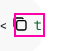

2. **2.01:1** (needs 4.5) · `div.hidden.flex-col:nth-of-type(3) > div.group\/card.flex:nth-of-type(3) > div.…` · “Update Security” · #FAFAFA on #B3B3B3 (mixed) · 1440px light · axe: **incomplete** · suggested `color.neutral.800` (5.57:1)

   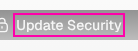

3. **3.63:1** (needs 4.5) · `div.group.relative:nth-of-type(4) > div.relative.overflow-hidden:nth-of-type(2)…` · “from” · #D73A49 on #E5E5E5 (mixed) · 1440px light · axe: **incomplete** · suggested `color.rose.700` (4.81:1)

   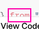

## Vercel templates

*Marketing site.*

Pages: <https://vercel.com/templates>, <https://vercel.com/templates/next.js/nextjs-commerce>

728 text elements measured across 8 page states. 46 contrast findings (axe: 10 incomplete, 0 pass, 0 not checked, 36 fail). Backgrounds: 46 solid, 0 gradient, 0 image, 0 mixed. 15 off-token colors (15 likely typos).

Most interesting findings that axe left incomplete or missed:

1. **2.38:1** (needs 4.5) · `#C2cbd9cb5-L1 > button.vF3MAa_lineNumber` · “1” · #A8A8A8 on #FFFFFF (solid) · 1440px light · axe: **incomplete** · suggested `color.accents.5` (5.74:1)

   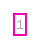

2. **2.38:1** (needs 4.5) · `#C7d72a332-L1 > button.vF3MAa_lineNumber` · “1” · #A8A8A8 on #FFFFFF (solid) · 1440px light · axe: **incomplete** · suggested `color.accents.5` (5.74:1)

   

3. **2.38:1** (needs 4.5) · `#C77e4551b-L1 > button.vF3MAa_lineNumber` · “1” · #A8A8A8 on #FFFFFF (solid) · 1440px light · axe: **incomplete** · suggested `color.accents.5` (5.74:1)

   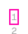

## Tailwind CSS and Tailwind Plus marketing

*Marketing site.*

Pages: <https://tailwindcss.com/>, <https://tailwindcss.com/plus>

1891 text elements measured across 8 page states. 131 contrast findings (axe: 65 incomplete, 13 pass, 21 not checked, 32 fail). Backgrounds: 95 solid, 8 gradient, 4 image, 24 mixed. 4 off-token colors (0 likely typos).

Most interesting findings that axe left incomplete or missed:

1. **1.05:1** (needs 4.5) · `div.\@container.isolate:nth-of-type(4) > div.h-112.p-4:nth-of-type(3) > div.-mr…` · “0.3 0.4 145” · #F8FAFC on #FFFFFF (gradient) · 375px light · axe: **incomplete** · suggested `color.neutral.500` (4.52:1)

   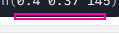

2. **1.05:1** (needs 4.5) · `div.\@container.isolate:nth-of-type(9) > div.h-112.p-4:nth-of-type(3) > div.-mr…` · “utilities” · #F8FAFC on #FFFFFF (gradient) · 375px light · axe: **incomplete** · suggested `color.neutral.500` (4.52:1)

   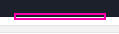

3. **2.69:1** (needs 4.5) · `span.not-group-has-data-xl\:opacity-40 > div.font-mono.text-\[13px\]\/7` · “xl” · #8F9096 on #ECECED (gradient) · 1440px light · axe: **incomplete**

   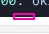

## Radix docs

*Documentation site.*

Pages: <https://www.radix-ui.com/>, <https://www.radix-ui.com/primitives/docs/overview/introduction>

768 text elements measured across 8 page states. 13 contrast findings (axe: 9 incomplete, 0 pass, 0 not checked, 4 fail). Backgrounds: 9 solid, 4 gradient, 0 image, 0 mixed. 5 off-token colors (0 likely typos).

Most interesting findings that axe left incomplete or missed:

1. **3.08:1** (needs 4.5) · `div.rt-Box.rt-r-p-6:nth-of-type(2) > div.rt-Flex.rt-r-fd-column > span.rt-Text.…` · “Sophie Johnson” · #FFFFFF on #A57DF3 (gradient) · 1440px light · axe: **incomplete** · suggested `color.mauve.12` (4.54:1)

   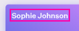

2. **3.81:1** (needs 4.5) · `div.rt-Box.rt-r-p-6:nth-of-type(2) > div.rt-Flex.rt-r-fd-column > div.rt-Box > …` · “4929 3849 5027 1846” · #FFFFFF on #7D73EA (gradient) · 1440px light · axe: **incomplete** · suggested `color.iris.9` (5.37:1)

   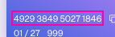

3. **1.91:1** (needs 3) · `div.rt-Flex.rt-r-fd-column:nth-of-type(1) > span.rt-Text.rt-r-size-5:nth-of-typ…` · “/ mo” · #B9BBC6 on #FFFFFF (solid) · 375px light · axe: **incomplete** · suggested `color.indigo.12` (13.22:1)

   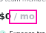

## Next.js docs

*Documentation site.*

Pages: <https://nextjs.org/>, <https://nextjs.org/docs>

930 text elements measured across 8 page states. 2 contrast findings (axe: 0 incomplete, 0 pass, 2 not checked, 0 fail). Backgrounds: 2 solid, 0 gradient, 0 image, 0 mixed. 25 off-token colors (25 likely typos).

Most interesting findings that axe left incomplete or missed:

1. **3.23:1** (needs 4.5) · `span.block.text-label-13-mono:nth-of-type(1)` · “$” · #8F8F8F on #FFFFFF (solid) · 375px light · axe: **not-checked** · suggested `color.accents.5` (5.74:1)

   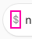

## MDN Web Docs

*Documentation site.*

Pages: <https://developer.mozilla.org/en-US/>, <https://developer.mozilla.org/en-US/docs/Web/CSS/color>

2541 text elements measured across 8 page states. 4 contrast findings (axe: 0 incomplete, 4 pass, 0 not checked, 0 fail). Backgrounds: 4 solid, 0 gradient, 0 image, 0 mixed. 32 off-token colors (0 likely typos).

Most interesting findings that axe left incomplete or missed:

1. **1.26:1** (needs 4.5) · `a > span.token.property` · “<color>” · #FF97A0 on #A4CEFE (solid) · 375px dark · axe: **pass** · suggested `color.csstools.light.dark.toggle.5e0f49fc.2` (6.43:1)

   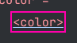

## GitHub marketing

*Marketing site.*

Pages: <https://github.com/>, <https://github.com/features/copilot>

1246 text elements measured across 8 page states. 0 contrast findings (axe: 0 incomplete, 0 pass, 0 not checked, 0 fail). Backgrounds: 0 solid, 0 gradient, 0 image, 0 mixed. 17 off-token colors (2 likely typos).

No contrast failures that axe missed.

## Stripe

*Marketing site.*

Pages: <https://stripe.com/>, <https://stripe.com/payments>

2929 text elements measured across 8 page states. 415 contrast findings (axe: 109 incomplete, 148 pass, 48 not checked, 110 fail). Backgrounds: 408 solid, 0 gradient, 1 image, 6 mixed. 120 off-token colors (8 likely typos).

Most interesting findings that axe left incomplete or missed:

1. **2.27:1** (needs 3) · `a.CustomersCaseStudyCard.theme--Dark:nth-of-type(4) > div.CustomersCaseStudyCar…` · “atVenu streamlines merchandise sales at live events with St…” · #FFFFFF on #35BADF (image) · 1440px dark · axe: **incomplete** · suggested `color.hds.color.core.neutralDark.700` (3.07:1)

   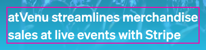

2. **1.07:1** (needs 3) · `h1.hds-heading.hero-section__title:nth-of-type(1) > span.hero-section__title-co…` · “Accept payments, handle business banking, and implement cus…” · #81B81A on #C49BFB (mixed) · 1440px light · axe: **incomplete** · suggested `color.hds.color.core.neutral.700` (3.72:1)

   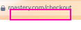

3. **1.08:1** (needs 3) · `h1.hds-heading.hero-section__title:nth-of-type(1) > span.hero-section__title-co…` · “1” · #81B81A on #FC84E1 (mixed) · 1440px light · axe: **incomplete** · suggested `color.hds.color.core.neutral.700` (3.79:1)

   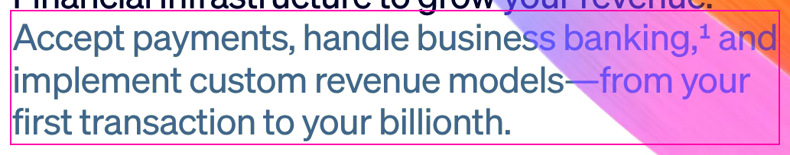

## Linear

*Marketing site.*

Pages: <https://linear.app/>, <https://linear.app/features>

1634 text elements measured across 8 page states. 356 contrast findings (axe: 278 incomplete, 0 pass, 42 not checked, 36 fail). Backgrounds: 352 solid, 2 gradient, 0 image, 2 mixed. 61 off-token colors (12 likely typos).

Most interesting findings that axe left incomplete or missed:

1. **3.09:1** (needs 4.5) · `div.KFZpfa_activityListRow:nth-of-type(2) > div.KFZpfa_activityText:nth-of-type…` · “added the labels and” · #62666D on #161819 (gradient) · 375px light · axe: **incomplete** · suggested `color.fg.tertiary` (5.48:1)

   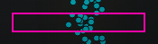

2. **3.09:1** (needs 4.5) · `div.bVIB3G_row:nth-of-type(4) > div.ImRUSq_root.ImRUSq_align-center:nth-of-type…` · “Working…” · #626366 on #0A160C (mixed) · 1440px light · axe: **incomplete** · suggested `color.sx.1d2fpwc` (5.88:1)

   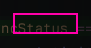

3. **1.96:1** (needs 4.5) · `span.wMQZWG_branchArrow:nth-of-type(2)` · “←” · #555557 on #28292A (solid) · 1440px light · axe: **incomplete** · suggested `color.sx.1d2fpwc` (4.63:1)

   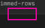

## Svelte

*Documentation site.*

Pages: <https://svelte.dev/>, <https://svelte.dev/docs/svelte/overview>

412 text elements measured across 8 page states. 19 contrast findings (axe: 7 incomplete, 6 pass, 0 not checked, 6 fail). Backgrounds: 16 solid, 0 gradient, 0 image, 3 mixed. 28 off-token colors (18 likely typos).

Most interesting findings that axe left incomplete or missed:

1. **2.90:1** (needs 4.5) · `a.cta.svelte-2ha69v` · “get started” · #F96743 on #484C51 (mixed) · 375px dark · axe: **incomplete** · suggested `color.shiki.token.function` (4.59:1)

   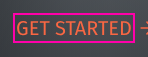

2. **3.53:1** (needs 4.5) · `kbd.svelte-curb4c:nth-of-type(1)` · “Ctrl” · #808080 on #F2F2F2 (solid) · 1440px light · axe: **incomplete** · suggested `color.sk.fg.3` (5.13:1)

   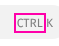

3. **3.53:1** (needs 4.5) · `kbd.svelte-curb4c:nth-of-type(2)` · “K” · #808080 on #F2F2F2 (solid) · 1440px light · axe: **incomplete** · suggested `color.sk.fg.3` (5.13:1)

   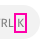

## Precision review

A deterministic, evenly spaced sample of 20 contrast findings across all sites was reviewed by hand against its screenshot crop: is the text really below the required contrast against what is really behind it? 20 reviewed, 20 true positives: **precision 100%**.

Third run, with the visibility and stability checks and the warm-up capture. All 20 sampled crops line up with their text boxes. Several true positives are decorative (code line numbers, a code illustration); they are real text below the threshold, which WCAG exempts only if it is pure decoration. The sample is spaced evenly over all findings, so it leans toward Stripe and Linear (14 of 20), which have the most. The reviewer is the agent that built RuGBy, so this is a self-assessment; the crops are in docs/case-studies/ for anyone to check.

| # | Site | Element | Ratio | Colors | axe | Label | Why |
|---|---|---|---:|---|---|---|---|
| S01 | shadcn | `div.flex.flex-col:nth-of-type(1) > div.group\/c…` “Real Estate” | 4.46 | #737373 on #F8F8F8 (solid) | incomplete | TP | Gray-500 category label on a light gray card: 4.46:1, just under 4.5. |
| S02 | shadcn | `span.line:nth-of-type(2) > span:nth-of-type(1)` “import” | 4.27 | #D73A49 on #F7F7F7 (solid) | incomplete | TP | Syntax-highlighted keyword (#d73a49) on the code block background: 4.27:1. |
| S03 | shadcn | `div.group.relative:nth-of-type(13) > div.relati…` “import” | 4.31 | #D73A49 on #F8F8F8 (solid) | incomplete | TP | Same keyword at 1440px: 4.31:1. |
| S04 | vercel-templates | `#C77e4551b-L2 > button.vF3MAa_lineNumber` “2” | 2.38 | #A8A8A8 on #FFFFFF (solid) | incomplete | TP | Code line number in light gray on white: 2.38:1 (decorative, but real text). |
| S05 | tailwind | `span.hidden.dark\:inline:nth-of-type(6)` “text-white” | 2.10 | #42454D on #030712 (solid) | fail | TP | Class name in a dark code illustration, dim gray on near-black: 2.10:1 (axe agrees; decorative). |
| S06 | tailwind | `p.text-fuchsia-500.dark\:text-fuchsia-400` “Tailwind in the wild” | 3.16 | #E12AFB on #F2F2F3 (mixed) | incomplete | TP | Fuchsia eyebrow heading on light gray at 12px/600: 3.16:1. |
| S07 | stripe | `div.platform-graphic__features--stacked:nth-of-…` “' capital-financing-promotion '” | 2.66 | #00B261 on #F8FAFD (solid) | incomplete | TP | Green string literal in a code sample on near-white: 2.66:1. The string rotates by animation; the colors and element are right. |
| S08 | stripe | `#stat-historical-uptime-description` “for Stripe services” | 3.21 | #7D8BA4 on #F8F6FE (solid) | incomplete | TP | Slate gray stat description at 16px/300 on a pale lavender panel: 3.21:1. |
| S09 | stripe | `div:nth-of-type(2) > div:nth-of-type(1) > span:…` “Tap, insert, or swipe to pay” | 4.04 | #727F96 on #FFFFFF (solid) | fail | TP | 9px gray caption in a payment-terminal graphic on white: 4.04:1 (axe agrees). |
| S10 | stripe | `#global-payments > div.Section__masked > div.Se…` “Global payments” | 3.49 | #9966FF on #F6F9FC (solid) | pass | TP | Purple heading text at 18px/500 (not large text): 3.49:1. |
| S11 | stripe | `div.PaymentsHeroAnimationCheckout__payment:nth-…` “Show all address fields” | 2.26 | #ADADAD on #FFFFFF (solid) | not-checked | TP | Faded 9px text in an illustrated address form on white: 2.26:1. axe did not check it. |
| S12 | stripe | `span.CodeEditorLineNumbers__number:nth-of-type(…` “4” | 2.73 | #55718D on #0C2E4E (solid) | pass | TP | Code line number in muted blue on navy: 2.73:1 (decorative). axe passed it. |
| S13 | stripe | `p > a.Link:nth-of-type(2)` “custom rules” | 3.68 | #9966FF on #FFFFFF (solid) | pass | TP | Purple inline link at 18px/425 (not large text) on white: 3.68:1. axe passed it. |
| S14 | stripe | `section.Copy.variant--Section > footer.Copy__fo…` “See all features” | 3.68 | #FFFFFF on #9966FF (solid) | fail | TP | White on a purple button: 3.68:1 (axe agrees). |
| S15 | linear | `div.KFZpfa_activityList:nth-of-type(4) > div.KF…` “Slack” | 3.09 | #62666D on #161819 (solid) | incomplete | TP | Dim gray integration name on near-black: 3.09:1. |
| S16 | linear | `div.KFZpfa_connectedRow:nth-of-type(3) > div.Im…` “2 min ago” | 2.92 | #62666D on #1D1D1F (solid) | incomplete | TP | Dim timestamp on dark gray: 2.92:1. |
| S17 | linear | `div._rhIjq_day:nth-of-type(4) > span.sc-KOGVz.j…` “23” | 3.37 | #62666D on #0C0D0D (solid) | incomplete | TP | Dim day number in a timeline on near-black: 3.37:1. |
| S18 | linear | `a.Jmh1Wq_legalLink.I_mUeq_root:nth-of-type(2)` “Terms” | 3.45 | #62666D on #08090A (solid) | fail | TP | Footer link, dim gray on near-black: 3.45:1 (axe agrees). |
| S19 | linear | `div.qM9FAa_col:nth-of-type(2) > div.ImRUSq_root…` “AI” | 4.11 | #72767D on #111213 (solid) | incomplete | TP | Tag text at 80% opacity on near-black: 4.11:1. |
| S20 | linear | `div.aFfDra_frame.aFfDra_highlightTopRight:nth-o…` “added to context” | 3.28 | #62666D on #101112 (solid) | incomplete | TP | Dim gray activity text on near-black: 3.28:1. |

### Earlier runs

- **First run:** 16 of 20 sampled findings were true positives (80%). The false positives: S07 (stripe): Measured on a pink background, but the screenshot shows white: the background was animated by JavaScript between captures. S08 (stripe): The text is not visible in the screenshot (covered or animated out), yet it was measured. S17 (linear): The text is not visible in the screenshot (covered), yet it was measured. S19 (linear): The text is not visible in the screenshot (covered), yet it was measured.
- **Second run:** With the visibility and stability checks. Its review was stopped at S11: S11's crop was empty although the text had been measured. That exposed that the first full-page capture of a page that re-lays-out still shows the old layout, so crops and the covered/animated comparison were misaligned on such pages (Stripe and Tailwind noted layout shifts). After the warm-up-capture fix, the third run (reviewed above) replaces it.

## False positives found and fixed

- Text that isn't visible (covered by another element or animated out) was measured: 3 of the 4 false positives in the first sample. RuGBy now compares the normal and the hidden-text capture inside each text box. If the text's color clearly differs from its background but hiding it changed no pixel, the text is skipped and noted. Fixture: fixtures/pages/covered.html.
- Text over JavaScript- or canvas-animated backgrounds was compared against a different frame: 1 of 4. If most of a text box changed between the two captures, the element is skipped and noted. Fixture: fixtures/pages/animated.html.
- The first full-page capture of a page that re-lays-out still shows the old layout, so the screenshot used for crops (and for the covered/animated check) did not line up with the measured text boxes on those pages. RuGBy now takes a throwaway capture first, and retakes both captures if text boxes move. Test: test/audit/alignment.test.ts.
- Found while preparing the runs: Chromium's first full-page capture re-lays-out pages that load a monospace fallback font for inline `<code>`, shifting text ~1px per row, so text far down long docs pages was compared against the wrong pixels. RuGBy now measures after the first capture and re-measures if boxes move. Fixture: fixtures/pages/code-grid.html.
- Also found while preparing: tight line-heights made neighbors' glyphs count as background (overlap batching), and Tailwind alpha modifiers flooded drift. Both fixed (see DECISIONS.md).

## What's next

- Label decorative text (illustrations, separators) separately. WCAG exempts pure decoration, and a heuristic (aria-hidden ancestors, role=presentation, UI mock-ups inside figures) could rank those findings lower.
- Pause requestAnimationFrame-driven animations instead of only skipping their text.
- Re-run with each site's real design tokens where they are published, for a meaningful drift signal.

